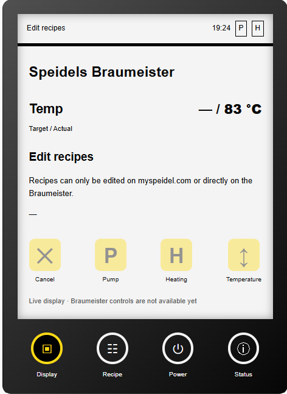

# Braumeister Display 0.6.1



## Install through HACS

1. In HACS, open the menu and select **Custom repositories**.
2. Add `https://github.com/DanielP-1337/braumeister-display-card` as **Dashboard**.
3. Download the card and reload the browser.
4. Verify the JavaScript module resource is
   `/hacsfiles/braumeister-display-card/braumeister-display-card.js`.
   If resources are managed in YAML, register this URL there yourself.

When migrating from the manual install, replace/remove the old
`/local/braumeister-display-card.js` resource. Load only one copy of the card.
Keep your card YAML and entity IDs. Do not uninstall the companion integration.

The HACS bundle contains all eight language catalogs. No JSON copy is required.
Optional files in `/config/www/braumeister-i18n/` override bundled translations;
`i18n_path` can select another `/local/` directory. Existing overrides are kept
outside the HACS-managed directory and survive upgrades. Missing JSON requests
are harmless; built-in translations remain available. Remove obsolete custom
files if you want the bundled translations to take effect.

The source file in the repository root remains suitable for manual installation
with JSON files as described below. The self-contained HACS file is in `dist/`.
A GitHub release alone does not add a repository to the HACS default catalog.

## Button ring colors

Open the card editor: **Appearance → Button lighting**. Choose a preset,
**Lights off**, or a custom color using the native picker / six-digit HEX field.
The HA preview updates immediately; use **Save** to persist the card configuration.
The editor preserves existing entity mappings and other YAML settings. Edit those
in the YAML editor as before. Labels follow the card's language setting.

All four lower navigation rings share the selected color. When the configured
`entities.plug` reports `off`, all rings become dark without changing the saved
color. When it reports `on`, the saved selection returns (including Lights off).
Cloud connectivity does not affect ring lighting. A missing plug entity or an
`unknown` / `unavailable` plug state does not count as confirmed power-off. The active tab is
underlined, including with the lighting off. **Default** preserves the previous
white/yellow ring colors. LCD colors and brightness stay unchanged. These are
local card preferences; no device command or hardware color synchronization is
performed. Preset colors are visual approximations, not official Speidel values.

Optional YAML (omit `button_color` for Default):

```yaml
button_color: '#00cfff'  # #RRGGBB, 'off', or 'default'
```

Quote HEX colors and `'off'` in YAML. Invalid values fall back to Default.

## Manual installation and compatibility

Standalone Home Assistant frontend card. Companion integration:
https://github.com/omphteliba/ha-speidel-braumeister

Full display attributes were tested with DanielP-1337’s integration fork
2.0.8-beta. Compatibility with upstream 3.0.0 is not yet hardware-verified;
missing attributes result in reduced display detail. This repository contains
no integration, bridge, firmware or cloud credentials.
Copy `braumeister-display-card.js` to `/config/www/braumeister-display-card.js`
and `i18n/*.json` to `/config/www/braumeister-i18n/` (see localization below).
Register the dashboard JavaScript module resource as
`/local/braumeister-display-card.js?v=0.6.1` (update the existing resource).
Reload the browser. Keep your existing card YAML and entity IDs; see example.yaml.
HACS integration updates do not copy this dashboard file to www.

The header combines recipe and phase. During rests, Zeit shows target and elapsed
minutes:seconds from device fields 6/7, without a client-side countdown.
Missing times show a dash; offline displays hide times and actuator highlights.
Original P/H flags from the current-step attributes take precedence over binary
sensors: P/H active yellow, q/i inactive diagonal yellow/white, p/h white.
Existing binary sensors and automations are unchanged. Older/cloud data without
these attributes retain the binary display. Unknown flags remain unknown in the
integration. No device controls or audio playback are added in this version.

The header clock uses device status field 1 unchanged; its RTC/time source is not established.
## Installation and entity selection

This is a frontend-only installation. Copy the JavaScript and language files as
shown below; no integration replacement or Home Assistant restart is required.
Keep the existing resource and card configuration when migrating from the
integration repository's dashboard folder.

Configure all entity IDs explicitly using `example.yaml`. In particular,
`entities.step` must reference the current-step sensor whose attributes include
`display_state_code`, `display_clock`, and `display_time_elapsed_seconds`.
The German translations currently give both current_phase and current_step the
name "Aktueller Schritt". Numeric entity-ID suffixes are installation-specific:
select by attributes in Developer Tools > States, not by the name or suffix.
The current-phase sensor can show the correct text while providing none of the
attributes required for the clock, rest timer, or diagonal actuator indicators.

## Hardware validation (2026-10-31)

User-reported test on a pre-2020 Braumeister 20 L Plus with external WLAN module,
firmware 1.1.27, using the local bridge and AdGuard DNS rewrite:

- MySpeidel commands reached the device after compressed-response handling was fixed.
- Home Assistant and MySpeidel showed synchronized temperatures and brewing steps.
- The dashboard displayed the device clock, target/elapsed rest time, and diagonal
  heater indication during temperature holding.
- During an automatic brew, the device was unplugged, left off, and powered on
  again. The user reported that the process continued at the same elapsed time
  and both dashboards remained synchronized.

This validates the observed automatic-brew scenario on that device; it is not a
claim that manual-mode actuators restart automatically or that the bridge
implements process persistence. The device owns the brewing process and timer.

## Display-only localization (card 0.6.1)

This update only changes the custom card. The Python integration, original
MySpeidel strings, entity IDs, states, attributes and service payloads remain
unchanged. Existing automations continue to compare the same backend values.
The eight initial catalogs are en-US, de, fr, es, it, pt, pl and nl.
These translations are initial drafts; native-speaker review is welcome.

Install BOTH the JavaScript and the language directory from this checkout:

```powershell
$repoPath = 'C:\Users\Fluse\Documents\git\speidel-braumeister\braumeister-display-card'
$wwwPath = '\\homeassistant.local\config\www'
New-Item -ItemType Directory -Path "$wwwPath\braumeister-i18n" -Force | Out-Null
Copy-Item -LiteralPath "$repoPath\braumeister-display-card.js" -Destination "$wwwPath\braumeister-display-card.js"
Copy-Item -Path "$repoPath\i18n\*.json" -Destination "$wwwPath\braumeister-i18n" -Force
```

Change the EXISTING dashboard resource URL to
`/local/braumeister-display-card.js?v=0.6.1` (JavaScript module), then reload the
browser with Ctrl+F5. Do not add a second resource for the same custom card.
No integration copy or HA restart is needed for this frontend-only update.
Back up any locally customized language files before copying over them.

Keep your existing `entities:` configuration. Optional card YAML:

```yaml
type: custom:braumeister-display-card
title: Speidels Braumeister
language: auto
# Keep all your existing entities here.
```

`auto` (also the default) follows `hass.locale.language`, then `hass.language`,
then the browser language. For a fixed override use `language: en-US`, `de`,
`fr`, etc. A language change redraws the card even if no sensor changes.
Number formatting follows that selected locale; device clock strings and
elapsed minutes:seconds retain their original meaning. Recipe names and
custom titles are not translated. No additional cloud polling is performed.

Resolution per label: exact locale file -> base language file -> en-US file
-> embedded US English -> original source text. Examples: de-DE -> de -> en-US;
fr-CA -> fr -> en-US. Missing, invalid or unreachable files fall back safely.
While a language file is loading, the embedded English labels may briefly show.
Files are cached per URL for the page lifetime; reload after editing a file.
Unknown firmware messages remain visible verbatim.

### Add your own language

Create `/config/www/braumeister-i18n/sv.json`, for example:

```json
{
  "Pumpenpause": "Pumppaus",
  "Zeit": "Tid",
  "{number}. Rast": "Mäskrast {number}"
}
```

Set `language: sv` or use a matching HA frontend language. There is no language
allowlist in the JavaScript. Partial dictionaries are supported. Keep existing
German/source keys exactly as written, including punctuation, capitalization
and placeholders. Translate only the JSON values. Save UTF-8 without a BOM.
Do not change native values such as on/off/previous in backend entities or
command payloads; their labels are translated separately.

To keep overrides separate from supplied files, set an alternate directory:
`i18n_path: /local/my-braumeister-languages`. That directory can contain your
custom catalogs and an optional en-US.json; embedded English remains available.
The JSON files contain plain text; values are escaped before HTML rendering.

For repository contributions, add `dashboard/i18n/<locale>.json`. No Python
changes are required. If updating the English source catalog, also update the
embedded ENGLISH object in the card; the tests enforce equality. Regional files
and additional languages can be partial. The eight bundled catalogs cover the
same source keys. Device messages with numbers use matching source templates
such as `{number}. Rast` and `Hopfen zugeben – {number}. Hopfengabe`.

Validate with Node.js:

```powershell
node --check dashboard/braumeister-display-card.js
node dashboard/test.cjs
node dashboard/test-i18n.cjs
```

This patch does not add the missing boiling timer or next-hop countdown UI.
Translation entries for hop messages translate them when provided as step text;
they do not calculate or synthesize new telemetry. No new device controls.
The integration's native HA entity names/translations are outside this patch.

Status code `6010` is displayed as “Rezepte bearbeiten” (English: “Edit recipes”).
This mapping is GUI-only; raw integration states and attributes remain unchanged.
Other unknown status codes retain the translated numeric fallback.

The recipe-editing display also explains that recipes can only be edited on
myspeidel.com or directly on the Braumeister. This localized hint is hidden
when the device is offline, powered off, or in another state.

The on-screen menu button animates while its action is pending. Set
`menu_pending_animation: false` in the card YAML to disable the animation.
The card also respects the system's reduced motion setting.

## Development

No npm dependencies are required. The deterministic build embeds the editable JSON catalogs into the HACS distribution. With Node.js installed:

```sh
node --check braumeister-display-card.js
node test.cjs
node test-i18n.cjs
node scripts/build.cjs
node test-bundle.cjs
node test-lighting.cjs
```

Automated checks cover offline masking, escaping, command routing, eight language
catalogs, locale fallback and state preservation. Hardware screenshots confirm
English and German recipe-editing text on the 20 L Plus.

## Known limitations

- Boiling target/elapsed time and the next-hop countdown are not displayed yet.
- Device controls remain disabled; only the separately configured smart plug
  and its power-on behavior selector can be controlled.
- HACS custom-repository installation is supported. Default-catalog inclusion is a separate review process.
- Native-speaker review of the initial translations is welcome.

## Origin and license

Extracted from `DanielP-1337/ha-speidel-braumeister`, dashboard commit
`a6b8a4f`, after the integration maintainer requested a separate frontend project.
The inherited MIT license is retained. This community project is not an official
Speidel product. Speidel and Braumeister names identify compatible equipment.

## Publish this source package

`Publish-Repository.ps1` checks Node tests and the active GitHub CLI account,
then creates the public `DanielP-1337/braumeister-display-card` repository and
pushes a new `main` branch. Requires Git, Node.js, GitHub CLI and configured Git
author identity. It stops on errors and never force-pushes or overwrites an
existing repository. No Home Assistant files are changed.
