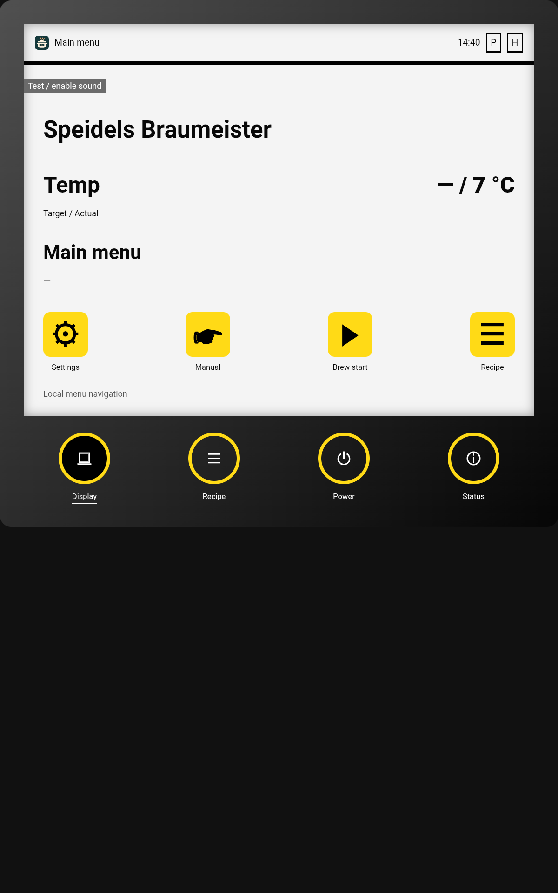
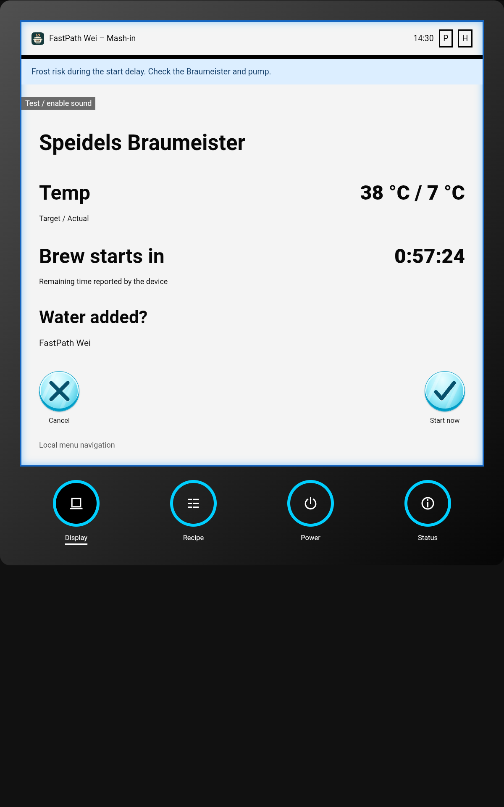

> New: [Direct start and alarm notifications](release-v0.7.0-beta.25.md).

> New: [Start now beta](release-v0.7.0-beta.24.md).

> New hardware-mapping beta: [versions, installation and test guide](release-v0.7.0-beta.23.md).

# Braumeister Display 0.7.0-beta.39

<a href="images/fire-hd-10-main-menu-after-cancel-beta39.png"></a>

## Frost warning during a delayed start

If you use the upstream Speidel Braumeister integration, the frost warning
requires a release that includes [PR #33](https://github.com/omphteliba/ha-speidel-braumeister/pull/33).
Upstream [v3.3.0](https://github.com/omphteliba/ha-speidel-braumeister/releases/tag/v3.3.0)
lacks the `display_start_delay_seconds` attribute on the current step sensor.
Both the card and the optional blueprint use this attribute to tell when the
start delay is active, so their frost warnings stay inactive with v3.3.0.

Enable **Frost warning** in the visual card editor and choose a water temperature
threshold (default 3 °C). The card shows a quiet blue frame and a text notice on
the current tab when the reported water temperature reaches that threshold. It
clears once the water warms more than 1 °C above it. A device alarm or pause takes
priority. This option starts disabled.

During a frost warning, the four navigation rings turn cyan and the display keys
take on a round, icy appearance. Clear **Use icy button colors during a frost warning**
in the card editor to keep your usual button style. The blue warning frame and
message stay visible with either choice.

The water confirmation followed by a running countdown (screen 2120) arms the
warning. This is an operator confirmation. The Braumeister reports the kettle
temperature, which can differ from the temperature inside the pump. The feature
provides a warning only. The next brew step or an offline connection clears the
card indication.

### Fire HD 10 hardware test

On November 22, 2026, the frost-style checkbox passed a hardware test on an
Amazon Fire HD 10 running Display Card `v0.7.0-beta.39`. The start delay was
active, the warning threshold was set to 8 °C, and the water measured 7 °C.

| Frost-style checkbox | Display keys | Four navigation rings | Frost warning |
| --- | --- | --- | --- |
| On (USB screenshot below) | Round, ice blue | Cyan | Blue frame and message visible |
| Off (observed by the tester on the tablet) | Yellow | Yellow | Blue frame and message still visible |

<a href="images/fire-hd-10-frost-warning-beta39.png"></a>

After the tester canceled the brew, the tablet returned to the [main menu shown above](images/fire-hd-10-main-menu-after-cancel-beta39.png).
The water still measured 7 °C. With the start delay over, the frost message
and blue frame cleared, and the menu keys and all four rings showed the saved
yellow color.

### Optional hourly forecast and phone notification

The [frost warning automation blueprint](blueprints/braumeister-frost-warning.yaml)
runs in Home Assistant even when the dashboard is closed.

1. In **Settings → Devices & services → Helpers**, create a **Timer** dedicated
   to this Braumeister. Enable state restoration if you want an active warning
   to survive an HA restart.
2. [Import the beta.39 blueprint into Home Assistant](https://my.home-assistant.io/redirect/blueprint_import/?blueprint_url=https%3A%2F%2Fgithub.com%2FDanielP-1337%2Fbraumeister-display-card%2Fblob%2Fv0.7.0-beta.39%2Fblueprints%2Fbraumeister-frost-warning.yaml).
   Choose **Create automation** under **Settings → Automations & scenes → Blueprints**.
3. In the blueprint form, choose the step, connection, water temperature and
   timer entities. Set the warning threshold. Optionally select a local weather
   entity that provides hourly forecasts and choose a lookahead. The automation
   checks the forecast only through the scheduled start, up to the chosen horizon.
4. For a push, add your HA Companion App phone's notification action and enter
   a message such as “Frostgefahr während der Startvorwahl. Bitte Braumeister
   und Pumpe prüfen.” Leave the action empty for a dashboard-only warning.
5. In the card's **Frost warning** settings, select the same timer. The
   automation now supplies the threshold and warning state for both channels.
   Use the automation's enable switch to control background monitoring.

HA checks on countdown entry, connection changes, startup and every five minutes.
Either a cold kettle or a low forecast can start a warning. The phone action
runs once when the timer first becomes active. Subsequent cold readings renew
the timer silently. The timer clears when the countdown ends or the available
inputs confirm recovery. If evaluations stop, the last warning expires within
12 minutes. An unavailable forecast still permits a warning from cold water.

**Disclaimer:** This project is an independent open-source development and is not affiliated with, funded by, or endorsed by Speidel Tank- und Behälterbau GmbH or any of its affiliates. "Braumeister" and "MySpeidel" are trademarks of their respective owners.

## Install through HACS

1. In HACS, open the menu and select **Custom repositories**.
2. Add `https://github.com/DanielP-1337/braumeister-display-card` as **Dashboard**.
3. Download the card and reload the browser.
4. Verify the JavaScript module resource is
   `/hacsfiles/braumeister-display-card/braumeister-display-card.js`.
   If resources are managed in YAML, register this URL there yourself.

When migrating from the manual install, replace/remove the old
`/local/braumeister-display-card.js` resource. Load only one copy of the card.
Keep your card YAML and entity IDs. Do not uninstall the companion integration.

The HACS bundle contains all eight language catalogs. No JSON copy is required.
Optional files in `/config/www/braumeister-i18n/` override bundled translations;
`i18n_path` can select another `/local/` directory. Existing overrides are kept
outside the HACS-managed directory and survive upgrades. Missing JSON requests
are harmless; built-in translations remain available. Remove obsolete custom
files if you want the bundled translations to take effect.

The source file in the repository root remains suitable for manual installation
with JSON files as described below. The self-contained HACS file is in `dist/`.
A GitHub release alone does not add a repository to the HACS default catalog.

## Device connection warning (beta)

Program-screen beta work (recipe confirmation, water prompt and the pause/abort
dialog) is documented in [program-screen controls](docs/program-screen-controls.md).
New enabled actions require Companion 0.1.0-beta.6 and experimental Bridge
0.3.2-control.4-beta.1. Water confirmation/delayed start and heating-stage resume
remain disabled; local command delivery on hardware is still awaiting validation.

The integration watchdog development adds a **Check device connection** problem
binary sensor. Map the entity ID from your device in the card YAML:

```yaml
entities:
  # Keep your other entity mappings here.
  connection_warning: binary_sensor.YOUR_ACTUAL_CONNECTION_WARNING_ENTITY
```

This optional mapping requires fork integration **3.1.1-beta.1**; it is not supplied
by upstream v3.1.0 or the companion. It does not
require changing the bridge or adding credentials. Existing cards without the
mapping keep their previous behavior.

When the sensor is on, a connection warning appears on **every card tab**.
It turns red if brewing or heater permission was last known active, including
a heater regulation pause. The text explicitly labels that activity as last
known and the current physical state as unknown. Live telemetry is masked and
bridge navigation/actuator controls are blocked. A configured sensor that is
unknown, unavailable or missing also blocks those controls and displays an
unverified-connection message. Smart-plug controls keep their existing behavior.
Fresh verified recovery restores the normal display; the card itself does not
probe or send shutdown commands. All eight bundled languages include the warning.

The watchdog expires after 120 seconds without advancing device evidence, with
a five-second local check interval. It cannot warn while HA is stopped or the
browser is disconnected from HA. HA restart/reload resets its last-known activity.
Local tests use synthetic states. The tester has confirmed the yellow warning
after powering off an idle appliance and the red warning after powering off with
the heater last known active. Recovery/reconnection, an automatic-brew outage,
and a network-only outage with the appliance still powered remain untested.

## Button ring colors

Open the card editor: **Appearance → Button lighting**. Choose a preset,
**Lights off**, or a custom color using the native picker / six-digit HEX field.
The HA preview updates immediately; use **Save** to persist the card configuration.
The editor preserves existing entity mappings and other YAML settings. Edit those
in the YAML editor as before. Labels follow the card's language setting.

All four lower navigation rings share the selected color. When the configured
`entities.plug` reports `off`, all rings become dark without changing the saved
color. When it reports `on`, the saved selection returns (including Lights off).
Cloud connectivity does not affect ring lighting. A missing plug entity or an
`unknown` / `unavailable` plug state does not count as confirmed power-off. The active tab is
underlined, including with the lighting off. **Default** preserves the previous
white/yellow ring colors. LCD colors and brightness stay unchanged. These are
local card preferences; no device command or hardware color synchronization is
performed. Preset colors are visual approximations, not official Speidel values.

Optional YAML (omit `button_color` for Default):

```yaml
button_color: '#00cfff'  # #RRGGBB, 'off', or 'default'
```

Quote HEX colors and `'off'` in YAML. Invalid values fall back to Default.

## Manual installation and compatibility

Standalone Home Assistant frontend card. Companion integration:
https://github.com/omphteliba/ha-speidel-braumeister

Full display attributes were tested with DanielP-1337’s integration fork
2.0.8-beta. Compatibility with upstream 3.0.0 is not yet hardware-verified;
missing attributes result in reduced display detail. This repository contains
no integration, bridge, firmware or cloud credentials.
Copy `braumeister-display-card.js` to `/config/www/braumeister-display-card.js`
and `i18n/*.json` to `/config/www/braumeister-i18n/` (see localization below).
Register the dashboard JavaScript module resource as
`/local/braumeister-display-card.js?v=0.6.1` (update the existing resource).
Reload the browser. Keep your existing card YAML and entity IDs; see example.yaml.
HACS integration updates do not copy this dashboard file to www.

The header combines recipe and phase. During rests, Zeit shows target and elapsed
minutes:seconds from device fields 6/7, without a client-side countdown.
Missing times show a dash; offline displays hide times and actuator highlights.
Original P/H flags from the current-step attributes take precedence over binary
sensors: P/H active yellow, q/i inactive diagonal yellow/white, p/h white.
Existing binary sensors and automations are unchanged. Older/cloud data without
these attributes retain the binary display. Unknown flags remain unknown in the
integration. No device controls or audio playback are added in this version.

The header clock uses device status field 1 unchanged; its RTC/time source is not established.
## Installation and entity selection

This is a frontend-only installation. Copy the JavaScript and language files as
shown below; no integration replacement or Home Assistant restart is required.
Keep the existing resource and card configuration when migrating from the
integration repository's dashboard folder.

Configure all entity IDs explicitly using `example.yaml`. In particular,
`entities.step` must reference the current-step sensor whose attributes include
`display_state_code`, `display_clock`, and `display_time_elapsed_seconds`.
The German translations currently give both current_phase and current_step the
name "Aktueller Schritt". Numeric entity-ID suffixes are installation-specific:
select by attributes in Developer Tools > States, not by the name or suffix.
The current-phase sensor can show the correct text while providing none of the
attributes required for the clock, rest timer, or diagonal actuator indicators.

### Tablet dashboard example — Fire HD and Samsung

Start with the [copy-and-paste dashboard template](examples/fire-hd-fully-kiosk-dashboard-template.yaml)
to create your own dashboard. It includes neutral example entity IDs and inline
setup instructions. Replace the IDs before use; they are placeholders, not
automatically discovered entities. Optional smart-plug mappings are marked.

[Complete dashboard YAML](examples/fire-hd-fully-kiosk-dashboard.yaml) reproduces
the tested HA dashboard configuration. User-reported successful tablet tests
(2026-11-06):

| Tablet | Reported test |
| --- | --- |
| Amazon Fire HD, model **TG425K** | Dashboard in kiosk mode with the [Fully Kiosk APK for Android / Fire OS](https://www.fully-kiosk.com/) |
| Samsung tablet, model **SM-X210** | Display Card dashboard successfully tested; browser/kiosk app not specified |

OS and app versions were not recorded. The filenames retain `fire-hd` for
existing links; the reusable template can also be adapted for other tablets.

Paste the example into the dashboard's raw configuration editor: it contains a
complete `views:` configuration, rather than just a single card. It uses a panel
view, automatic language selection, cyan buttons and manual menu/pump/heater
controls. Replace all entity IDs, including their numeric suffixes, with your own;
choose the current-step sensor by its attributes as described above. The
`connection_warning` mapping is included.

The `kiosk_mode` block is preserved from the tested dashboard's separate kiosk
setup; it is not a Display Card option. The control options require the matching
Companion/Bridge configuration described in this README. This report covers the
dashboard on the reported tablet setups, not every control action or tablet model.

### Smartphone dashboard tests

On 2026-11-07, a user reported successful Display Card dashboard tests on these Samsung phones:

- Samsung Galaxy S10 Plus
- Samsung Galaxy S21 Ultra 5G
- Samsung Galaxy S23 Ultra
- Samsung Galaxy S25 Ultra

Separate tests on Apple and Xiaomi devices are pending.

## Hardware validation (2026-10-31)

User-reported test on a pre-2020 Braumeister 20 L Plus with external WLAN module,
firmware 1.1.27, using the local bridge and AdGuard DNS rewrite:

- MySpeidel commands reached the device after compressed-response handling was fixed.
- Home Assistant and MySpeidel showed synchronized temperatures and brewing steps.
- The dashboard displayed the device clock, target/elapsed rest time, and diagonal
  heater indication during temperature holding.
- During an automatic brew, the device was unplugged, left off, and powered on
  again. The user reported that the process continued at the same elapsed time
  and both dashboards remained synchronized.

This validates the observed automatic-brew scenario on that device; it is not a
claim that manual-mode actuators restart automatically or that the bridge
implements process persistence. The device owns the brewing process and timer.

## Live test coverage for locales and units

Live testing with MySpeidel and a physical Braumeister has so far used a German MySpeidel account, Celsius (°C), Plato (°P), and German date and time formats.

- **MySpeidel account settings:** English, Fahrenheit (°F), and Specific Gravity (SG) have not been tested against the live API. Whether these settings change API values, units, field formats, or only the portal display is unknown. Test each setting separately against the German / °C / °P baseline, then test them together.
- **System and browser locale:** Live tests with non-German system or browser languages and date/time formats, such as en-US, are pending. Test language and formatting separately while keeping the time zone fixed. Include 12-hour and 24-hour display, date rollover, and RTC monitoring where applicable.

The Card's existing translation tests cover UI labels. Live validation of temperature units, recipe gravity, and clock rendering under alternate account settings and locales is still pending.

## Display-only localization (card 0.6.1)

This update only changes the custom card. The Python integration, original
MySpeidel strings, entity IDs, states, attributes and service payloads remain
unchanged. Existing automations continue to compare the same backend values.
The eight initial catalogs are en-US, de, fr, es, it, pt, pl and nl.
These translations are initial drafts; native-speaker review is welcome.

Install BOTH the JavaScript and the language directory from this checkout:

```powershell
$repoPath = 'C:\Users\Fluse\Documents\git\speidel-braumeister\braumeister-display-card'
$wwwPath = '\\homeassistant.local\config\www'
New-Item -ItemType Directory -Path "$wwwPath\braumeister-i18n" -Force | Out-Null
Copy-Item -LiteralPath "$repoPath\braumeister-display-card.js" -Destination "$wwwPath\braumeister-display-card.js"
Copy-Item -Path "$repoPath\i18n\*.json" -Destination "$wwwPath\braumeister-i18n" -Force
```

Change the EXISTING dashboard resource URL to
`/local/braumeister-display-card.js?v=0.6.1` (JavaScript module), then reload the
browser with Ctrl+F5. Do not add a second resource for the same custom card.
No integration copy or HA restart is needed for this frontend-only update.
Back up any locally customized language files before copying over them.

Keep your existing `entities:` configuration. Optional card YAML:

```yaml
type: custom:braumeister-display-card
title: Speidels Braumeister
language: auto
# Keep all your existing entities here.
```

`auto` (also the default) follows `hass.locale.language`, then `hass.language`,
then the browser language. For a fixed override use `language: en-US`, `de`,
`fr`, etc. A language change redraws the card even if no sensor changes.
Number formatting follows that selected locale; device clock strings and
elapsed minutes:seconds retain their original meaning. Recipe names and
custom titles are not translated. No additional cloud polling is performed.

Resolution per label: exact locale file -> base language file -> en-US file
-> embedded US English -> original source text. Examples: de-DE -> de -> en-US;
fr-CA -> fr -> en-US. Missing, invalid or unreachable files fall back safely.
While a language file is loading, the embedded English labels may briefly show.
Files are cached per URL for the page lifetime; reload after editing a file.
Unknown firmware messages remain visible verbatim.

### Add your own language

Create `/config/www/braumeister-i18n/sv.json`, for example:

```json
{
  "Pumpenpause": "Pumppaus",
  "Zeit": "Tid",
  "{number}. Rast": "Mäskrast {number}"
}
```

Set `language: sv` or use a matching HA frontend language. There is no language
allowlist in the JavaScript. Partial dictionaries are supported. Keep existing
German/source keys exactly as written, including punctuation, capitalization
and placeholders. Translate only the JSON values. Save UTF-8 without a BOM.
Do not change native values such as on/off/previous in backend entities or
command payloads; their labels are translated separately.

To keep overrides separate from supplied files, set an alternate directory:
`i18n_path: /local/my-braumeister-languages`. That directory can contain your
custom catalogs and an optional en-US.json; embedded English remains available.
The JSON files contain plain text; values are escaped before HTML rendering.

For repository contributions, add `dashboard/i18n/<locale>.json`. No Python
changes are required. If updating the English source catalog, also update the
embedded ENGLISH object in the card; the tests enforce equality. Regional files
and additional languages can be partial. The eight bundled catalogs cover the
same source keys. Device messages with numbers use matching source templates
such as `{number}. Rast` and `Hopfen zugeben – {number}. Hopfengabe`.

Validate with Node.js:

```powershell
node --check dashboard/braumeister-display-card.js
node dashboard/test.cjs
node dashboard/test-i18n.cjs
```

This patch does not add the missing boiling timer or next-hop countdown UI.
Translation entries for hop messages translate them when provided as step text;
they do not calculate or synthesize new telemetry. No new device controls.
The integration's native HA entity names/translations are outside this patch.

Status code `6010` is displayed as “Rezepte bearbeiten” (English: “Edit recipes”).
This mapping is GUI-only; raw integration states and attributes remain unchanged.
Other unknown status codes retain the translated numeric fallback.

The recipe-editing display also explains that recipes can only be edited on
myspeidel.com or directly on the Braumeister. This localized hint is hidden
when the device is offline, powered off, or in another state.

The on-screen menu button animates while its action is pending. Set
`menu_pending_animation: false` in the card YAML to disable the animation.
The card also respects the system's reduced motion setting.

### Manual controls

The manual screen supports pump and heater actions with an updated
Braumeister Local Menu companion that exposes `braumeister_menu.set_actuator`
and Bridge `0.3.2-control.3-beta.3` for independent pump and heater control.

```yaml
menu_control: true
manual_pump_control: true
manual_heater_control: true
```

Both controls default to off. Enable `manual_pump_enabled` or
`allow_remote_heating` on the Bridge for the corresponding control.
The card uses the step entity's reported actuator flags and asks for
confirmation before sending a heater-on request. Temperature opens a
read-only view of the current and target temperatures.

## Development

No npm dependencies are required. The deterministic build embeds the editable JSON catalogs into the HACS distribution. With Node.js installed:

```sh
node --check braumeister-display-card.js
node test.cjs
node test-i18n.cjs
node scripts/build.cjs
node test-bundle.cjs
node test-lighting.cjs
```

Automated checks cover offline masking, escaping, command routing, eight language
catalogs, locale fallback and state preservation. Hardware screenshots confirm
English and German recipe-editing text on the 20 L Plus.

## Known limitations

- Boiling target/elapsed time and the next-hop countdown are not displayed yet.
- Device controls remain disabled; only the separately configured smart plug
  and its power-on behavior selector can be controlled.
- HACS custom-repository installation is supported. Default-catalog inclusion is a separate review process.
- Native-speaker review of the initial translations is welcome.

### Header progress and repeating sound (0.7.0-beta.26)

The existing black header divider fills yellow from left to right using
`entities.progress`, the integration's reported percentage (including heating).
No estimate is made from temperature or time. Missing, invalid, offline, or
stale readings leave it black. Configure the progress entity in the card YAML.

When sound is enabled, `alarm_repeat` defaults to true: a short tone or up to
five seconds of your own audio repeats every six seconds while the device
reports the alarm/pause. Disable repetition in the visual editor for one-shot
audio. Mute sound silences the current notification locally; it never sends a
device command. The next alarm after acknowledgment can sound again. Playback
stops on acknowledgment, connection loss, or removing the card. Browser audio
permission/background restrictions still apply; test sound on each device.

Resume now includes the hardware-observed states 2310 and 2810. It requires
Companion 0.1.0-beta.16 and Bridge 0.5.1-beta.8 with existing program/heating
permissions. Other unverified resume contexts remain unavailable.

## Origin and license

Extracted from `DanielP-1337/ha-speidel-braumeister`, dashboard commit
`a6b8a4f`, after the integration maintainer requested a separate frontend project.
The inherited MIT license is retained. This community project is not an official
Speidel product. Speidel and Braumeister names identify compatible equipment.

## Publish this source package

`Publish-Repository.ps1` checks Node tests and the active GitHub CLI account,
then creates the public `DanielP-1337/braumeister-display-card` repository and
pushes a new `main` branch. Requires Git, Node.js, GitHub CLI and configured Git
author identity. It stops on errors and never force-pushes or overwrites an
existing repository. No Home Assistant files are changed.
