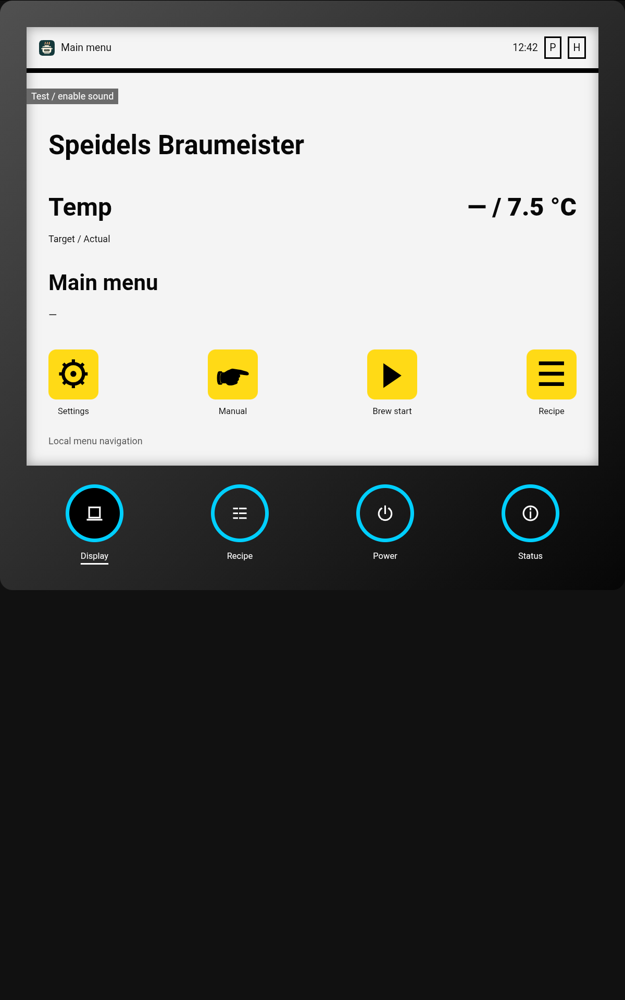
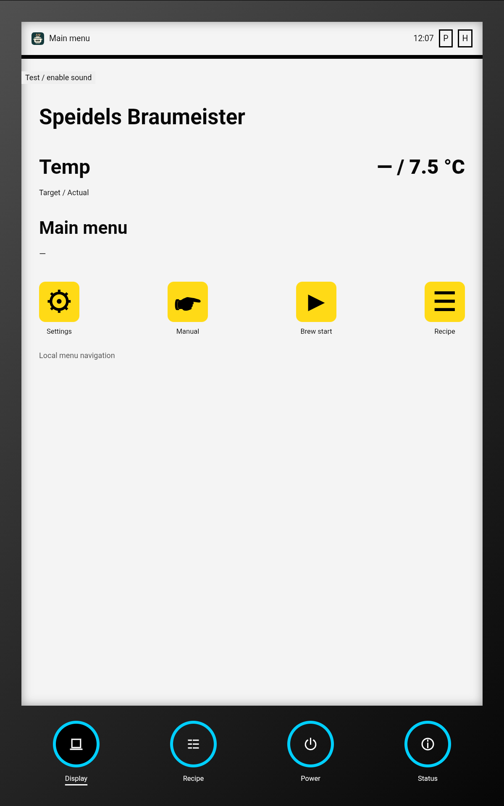

# Android-Tablets: ADB einrichten

Die Skripte stellen Android Debug Bridge (ADB) bereit, prüfen die Verbindung zu Android-Tablets verschiedener Hersteller und speichern Modell und Android-Version. Bei Fire-Geräten wird zusätzlich Fire OS angezeigt. Android Studio ist nicht erforderlich. Fehlende Platform Tools werden von Google heruntergeladen; dafür ist eine Internetverbindung nötig.

## 1. Tablet vorbereiten

1. **Einstellungen → Über das Tablet / Tablet-Info → Softwareinformationen** öffnen (Menüpfad je nach Hersteller unterschiedlich).
2. Die **Buildnummer siebenmal** antippen und gegebenenfalls die Geräte-PIN eingeben. Bei **Amazon Fire** stattdessen unter **Geräteoptionen → Über das Fire-Tablet** die **Seriennummer siebenmal** antippen.
3. Zurück unter **Entwickleroptionen** die Option **USB-Debugging / ADB** aktivieren.
4. Tablet mit einem **USB-Datenkabel** verbinden und entsperren.
5. Sobald der Dialog erscheint, **USB-Debugging für den eigenen Computer zulassen**.

## 2. Skript starten

### Windows

1. `Setup-Android-ADB.ps1` im Projektordner ablegen.
2. PowerShell in diesem Ordner öffnen (Windows PowerShell 5.1 oder PowerShell 7).
3. Ausführen:

```powershell
powershell.exe -NoProfile -ExecutionPolicy Bypass -File .\Setup-Android-ADB.ps1
```

`Bypass` gilt nur für diesen Prozess. Falls Windows das Tablet nicht erkennt, den passenden USB-Treiber des Herstellers installieren: [Android-Treiberübersicht](https://developer.android.com/studio/run/oem-usb). Für Fire-Geräte siehe [Amazons ADB-Anleitung](https://developer.amazon.com/docs/fire-tablets/connecting-adb-to-device).

### Linux

1. `Setup-Android-ADB.sh` im Projektordner ablegen. Bash ab 3.2 sowie `curl` und `unzip` müssen installiert sein.
2. Ein Terminal im Projektordner öffnen und als normaler Benutzer ausführen:

```bash
bash ./Setup-Android-ADB.sh
```

Bei fehlenden USB-Zugriffsrechten die udev-Regeln und Gruppenmitgliedschaft prüfen. Für Ubuntu beschreibt [Google die Einrichtung mit `plugdev` und `android-sdk-platform-tools-common`](https://developer.android.com/studio/run/device).

Der automatische Linux-Download unterstützt x86_64. Unter ARM-Linux ein natives ADB über den Paketmanager installieren und stattdessen starten mit:

```bash
bash ./Setup-Android-ADB.sh --adb "$(command -v adb)"
```

### macOS

1. `Setup-Android-ADB.sh` im Projektordner ablegen. Bash ab 3.2 sowie `curl` und `unzip` werden benötigt.
2. Terminal öffnen und mit `cd "/Pfad/zum/Projektordner"` in den Ordner wechseln.
3. Ausführen:

```bash
bash ./Setup-Android-ADB.sh
```

Das Skript lädt bei Bedarf Googles Mac-Paket. Zusätzliche USB-Treiber sind laut [Google](https://developer.android.com/studio/run/device) nicht erforderlich.

## 3. Ergebnis prüfen

Das Skript wartet standardmäßig bis zu **90 Sekunden** auf die Gerätefreigabe. Bei Erfolg erscheinen Modell, Seriennummer, Android, API-Level und Build-ID im Terminal. **Fire OS** erscheint nur bei Amazon-Geräten oder wenn das Gerät ausdrücklich eine Fire-OS-Version meldet.

Die Angaben werden zusätzlich mit UTC-Zeitpunkt in **`Android-Geraeteinformationen.txt`** neben dem Skript gespeichert. Jeder erfolgreiche Durchlauf ersetzt den vorherigen Bericht, auch beim Wechsel des Tablets. Ohne die optionalen Fully- und Akkuschutz-Optionen werden keine Apps installiert oder Tablet-Einstellungen geändert.

Bekannte Modellkennungen werden als **Samsung Galaxy Tab A9+ (Wi-Fi)** (`SM-X210`) bzw. **Amazon Fire HD 10 (2023, 13. Generation)** (`KFTUWI`) angezeigt. Andere Geräte werden mit ihrem gemeldeten Hersteller und Modell angezeigt, ohne Herstellerwarnung. Es gibt keine vollständige Modellnamendatenbank. Quellen: [Samsung](https://www.samsung.com/de/support/model/SM-X210NZAAEUB/), [Amazon](https://developer.amazon.com/docs/device-specs/ft-identify-tablet-devices).

## 4. Weitere Optionen nutzen

Diese Optionen an den jeweiligen Startbefehl aus Schritt 2 anhängen:

| Zweck | Windows | Linux / macOS |
|---|---|---|
| Nur ADB bereitstellen | `-InstallOnly` | `--install-only` |
| Bestimmtes Gerät auswählen | `-Serial 'SERIENNUMMER'` | `--serial 'SERIENNUMMER'` |
| 120 Sekunden warten | `-TimeoutSeconds 120` | `--timeout 120` |
| Anderen Tools-Ordner verwenden | `-ToolsDirectory 'C:\ADB'` | `--tools-directory "$HOME/AndroidTools"` |

Bei **unauthorized** den Dialog am Tablet bestätigen; bei **offline** das Kabel neu verbinden. Bei mehreren Geräten die gewünschte Seriennummer angeben. Vorhandene Platform Tools werden wiederverwendet, aber nicht automatisch aktualisiert.

Weitere Details stehen in `ADB-Einrichtung.md`. Die Windows-Version wurde mit Fire HD 10 und Samsung Galaxy Tab A9+ getestet; die Bash-Version wurde auf Syntax und mit simulierten Linux-/macOS-Verbindungen geprüft. Ein echter USB-Test unter Linux/macOS steht noch aus.

## 5. Fully Kiosk installieren oder aktualisieren und Dashboard einrichten

Den Projektordner einschließlich `scripts/` und `fully-ha-settings.json` verwenden. Tablet verbinden und den gewünschten Startbefehl ausführen:

```powershell
powershell.exe -NoProfile -ExecutionPolicy Bypass -File .\Setup-Android-ADB.ps1 -Serial 'SERIENNUMMER' -SetupFully -FullyLayout compact
```

```bash
bash ./Setup-Android-ADB.sh --serial 'SERIENNUMMER' --setup-fully --fully-layout compact
```

Dabei wird die aktuelle reguläre APK von der offiziellen Fully-Downloadseite geladen und mit `adb install -r` installiert bzw. aktualisiert. Bei Signaturkonflikten oder einem neueren installierten Stand bricht das Skript ab; es deinstalliert nichts automatisch. Alternativ eine bereits heruntergeladene offizielle APK angeben: `-FullyApkPath 'C:\Downloads\Fully.apk'` bzw. `--fully-apk "$HOME/Downloads/Fully.apk"` zusätzlich zur Setup-Option.

Das gemeinsame Profil `fully-ha-settings.json` richtet dasselbe Dashboard wie auf dem Fire HD 10 ein:

`http://192.168.2.56:8123/firehd-braumeister/braumeister_tablet`

Es setzt Startseite, Vollbild ohne Aktionsleiste, Hochformat, Display-an während der Nutzung, Autostart und Neuladen nach WLAN-Verbindung. Die JavaScript-Anpassung blendet HA-Kopfzeile und Seitenleiste nur für dieses Dashboard aus und setzt einen dunklen Außenhintergrund. Die Kartenhöhe wählst du ausdrücklich mit `compact` oder `fullscreen` (siehe unten). Ohne diese Auswahl bricht die Fully-Einrichtung vor dem Gerätezugriff ab. Das Tablet muss die konfigurierte HA-Adresse erreichen können.

Der Import erteilt Fully den nötigen Speicherzugriff, startet die App neu und wartet auf die Verarbeitung von `fully-once-settings.json`. Bei offenen Berechtigungsdialogen am Tablet bestätigen. Bei Erfolg gegebenenfalls **einmal direkt in Home Assistant anmelden**. Passwörter, PINs, Lizenzdaten und Anmeldesitzungen werden nicht kopiert. PLUS-Funktionen benötigen eine Lizenz für das jeweilige Tablet. Eine Sperre gegen das Verlassen der App und die HA-Fully-Integration werden nicht automatisch aktiviert.

Für den Start als Kiosk zusätzlich am Tablet den Kiosk-Modus mit eigener PIN aktivieren, angeforderte Berechtigungen prüfen und **Fully Kiosk Browser als Standard-Home-App** wählen. Eine parallel installierte Fully Single App Kiosk ist eine andere App; sie wurde auf dem Testgerät separat deaktiviert. Diese Schritte erledigen die Setup-Skripte nicht automatisch.

Neustarttests am Samsung (21.11.2026): Nach dieser Korrektur blieb der erste Durchlauf länger auf „Loading…“. Ein zweiter vollständiger Neustart zeigte das angemeldete Dashboard automatisch im Vollbild, ohne App-Start oder Menübedienung durch den Tester. Die Ursache des ersten Hängers ist offen. Details in `ADB-Einrichtung.md`.

## 6. Darstellung bewusst wählen

Beide Layouts funktionieren auf beiden Tablet-Modellen. **Fully-Vollbild** (keine Android-/Browserleisten) bleibt in beiden Fällen aktiv. Die Auswahl betrifft die **Höhe der Dashboard-Karte**:

| | `compact` – kompakt | `fullscreen` – bildschirmfüllend |
|---|---|---|
| Kartenhöhe | Nach Inhalt; unten kann dunkle Fläche bleiben | Mindestens die Bildschirmhöhe |
| Außenkanten | Ursprünglich abgerundet | Gerade, ohne Außenradius |
| Innenbereich und Navigation | Navigation direkt unter dem Inhalt | Heller Innenbereich wächst; Navigation wandert nach unten |
| Schrift und Tasten | Unverändert | Unverändert; kein Zoom |
| Referenz im Hochformat | Fire HD 10 | Samsung Galaxy Tab A9+ |
| Screenshot |  |  |

Aufnahmen vom 21.11.2026, jeweils **1200 × 1920 Pixel**. Die kompakte Referenz zeigt die bisherige Fire-Darstellung (Kartenhöhe ca. 1133 Pixel); die Samsung-Referenz zeigt das neue Vollhöhenlayout. Der dunkle Außenhintergrund wird jetzt in beiden Varianten unabhängig vom Systemmodus gesetzt. Lange Inhalte bleiben scrollbar. Diese lokale Fully-Anpassung ändert weder das HA-Benutzer-Theme noch die Darstellung auf anderen Geräten.

Bei der Einrichtung oben `compact` durch `fullscreen` ersetzen, wenn die Karte den Bildschirm ausfüllen soll. Ein späterer Wechsel benötigt keine erneute APK-Installation:

```powershell
# Windows: nur Darstellung einer bereits installierten Fully-App ändern
.\Setup-Android-ADB.ps1 -Serial 'SERIENNUMMER' -FullyLayout fullscreen
# Zurück zur kompakten Darstellung:
.\Setup-Android-ADB.ps1 -Serial 'SERIENNUMMER' -FullyLayout compact
```

```bash
# Linux/macOS: nur Darstellung ändern
bash ./Setup-Android-ADB.sh --serial 'SERIENNUMMER' --fully-layout fullscreen
# Zurück zur kompakten Darstellung:
bash ./Setup-Android-ADB.sh --serial 'SERIENNUMMER' --fully-layout compact
```

Der reine Layout-Wechsel importiert **nur `injectJsCode`** aus dem mitgelieferten Profil und startet Fully neu. Er ersetzt dabei eventuell vorhandenes eigenes Inject-JavaScript; vorher sichern bzw. zusammenführen. Startadresse, Ausrichtung, Kiosk-PIN und Akkuschutz werden dabei nicht gesetzt. Der Host-/Pfadfilter im Profil muss zur bereits verwendeten Dashboard-Adresse passen. Fully muss installiert sein und der automatische Einstellungsimport aktiviert sein. Bei einer Bedienungshilfen-Freigabe nach dem Neustart prüfen, ob sie erhalten blieb, insbesondere auf Fire OS. Die gewählte Variante wird nach verarbeitetem Import im Gerätebericht vermerkt.

## 7. Heimnetz, Hotspot und Fernzugriff

Fully kann auch über einen Handy-Hotspot auf HA zugreifen. Bei **Nabu Casa** in `fully-ha-settings.json` die `startURL` auf die eigene HTTPS-Fernzugriffsadresse plus Dashboard-Pfad umstellen und den Host-/Pfadfilter in `injectJsCode` entsprechend anpassen. Auf der neuen Adresse in HA anmelden. Die bisherige LAN-IP ist über einen gewöhnlichen Hotspot nicht erreichbar. [Nabu-Casa-Einrichtung](https://support.nabucasa.com/hc/en-us/articles/26474279202973-Enabling-remote-access-to-Home-Assistant)

**Tailscale** wurde auf einem Raspberry Pi 5 mit Home Assistant sowie auf beiden Tablets eingerichtet und getestet. Alle drei Geräte sind im selben privaten Tailscale-Netz (Tailnet) angemeldet. Eine freigegebene Route nur zum HA-Server erhält die bisherige Dashboard-Adresse und damit die vorhandene HA-Anmeldung sowie den Host-/Pfadfilter des Inject-JavaScripts.

Die folgenden Schritte erfolgen **separat von den Setup-Skripten**. `Setup-Android-ADB.ps1` und `.sh` installieren oder konfigurieren weiterhin weder Tailscale noch Nabu Casa.

### Tailscale auf dem Raspberry Pi 5 mit Home Assistant

1. In Home Assistant unter **Einstellungen → Apps → App-Store** die **Home Assistant Community App: Tailscale** installieren. Voraussetzung ist eine HA-Installation mit App-/Add-on-Unterstützung und ein bestehender Tailscale-Account.
2. In der App-Konfiguration die unten gezeigten Werte setzen. `192.168.2.56` ist die HA-Adresse dieses Projekts; bei einer anderen Installation durch die eigene feste HA-LAN-Adresse ersetzen. `/32` bezeichnet genau diesen einen Host.
3. **Start on boot** und **Watchdog** aktivieren, die App starten und **Open Web UI** öffnen. Über **Log In** mit dem bestehenden Account anmelden und das HA-Gerät mit **Connect device** verbinden.
4. In der [Tailscale-Geräteverwaltung](https://console.tailscale.com/admin/machines) beim HA-Gerät unter **Subnets → Review/Edit** genau die angebotene HA-Route freigeben. Erst dann können die Tablets diese LAN-Adresse über das VPN erreichen.
5. In der Geräteübersicht prüfen, dass HA und beide Tablets verbunden sind. Bei angepassten Tailnet-Zugriffsregeln muss der Zugriff der Tablets auf HA, hier TCP-Port `8123`, erlaubt sein.

Die im Test verwendeten Einstellungen als Ausschnitt der App-Konfiguration:

```yaml
accept_dns: false
accept_routes: false
advertise_routes:
  - 192.168.2.56/32
advertise_exit_node: false
userspace_networking: false
snat_subnet_routes: true
```

`accept_dns: false` behält die bestehende DNS-Konfiguration des HA-Hosts bei. Es wurde kein Exit Node und kein öffentlicher Funnel eingerichtet. Die Route stellt nur den HA-Host bereit, nicht das gesamte Heimnetz. Weitere Optionen und deren Bedeutung stehen in der [Dokumentation der HA-Community-App](https://github.com/hassio-addons/app-tailscale/blob/main/tailscale/DOCS.md).

Für HA-Befehle **an Fully** (z. B. Bildschirm ein/aus) ist zusätzlich die Rückverbindung zur Tablet-VPN-Adresse nötig. Dafür wurde `userspace_networking: false` gewählt; außerdem müssen Fullys Remote Administration und passende Zugriffsregeln eingerichtet sein. Dieser Rückweg ist vom hier geprüften Dashboard-Zugriff zu unterscheiden und wurde nicht als HA-Fernsteuerungstest abgenommen. [Fully-Fernsteuerung](https://www.fully-kiosk.com/docs/en/features/remote-admin)

### Tailscale auf Samsung und Fire HD 10

1. Fully vorübergehend über die eigene Kiosk-PIN verlassen, damit Anmelde- und Android-VPN-Dialoge im Vordergrund bleiben. Tailscale aus einer offiziellen Quelle installieren: [Android-Anleitung](https://tailscale.com/docs/install/android) bzw. [Fire-Anleitung und Universal-APK](https://tailscale.com/docs/install/amazon-fire). Im Test wurde auf **beiden** Tablets die offizielle Universal-APK `1.104.7` installiert und deren SHA-256 mit dem Herstellerdownload verglichen. Eine per APK installierte Version bei Bedarf manuell aktualisieren.
2. Tailscale öffnen, die Android-VPN-Verbindungsanfrage bestätigen und jedes Tablet mit demselben bestehenden Account anmelden. Die Geräteverknüpfung kann über den jeweiligen Anmeldelink auch am Notebook bestätigt werden. Anschließend muss Tailscale **Connected** anzeigen; ein Exit Node ist für diesen Aufbau nicht erforderlich.
3. In den Android-VPN-Einstellungen für Tailscale **Durchgehend aktives VPN / Always-on VPN** aktivieren. **Verbindungen ohne VPN blockieren** blieb im Test ausgeschaltet. Beim Fire ließ sich die VPN-Einstellungsseite über ADB öffnen; dort das Zahnrad neben Tailscale verwenden:

   ```powershell
   .\tools\platform-tools\adb.exe -s 'SERIENNUMMER' shell am start -a android.settings.VPN_SETTINGS
   ```

4. Auf dem Samsung-Testgerät wurde Always-on stattdessen per ADB gesetzt und **nach einem vollständigen Neustart** im VPN-Dienst mit `alwaysOn=true` bestätigt:

   ```powershell
   .\tools\platform-tools\adb.exe -s 'SERIENNUMMER' shell settings put secure always_on_vpn_app com.tailscale.ipn
   # Nach dem Neustart prüfen:
   .\tools\platform-tools\adb.exe -s 'SERIENNUMMER' shell settings get secure always_on_vpn_app
   .\tools\platform-tools\adb.exe -s 'SERIENNUMMER' shell dumpsys vpn_management
   ```

   Dies ist ein am SM-X210 mit Android 16 geprüfter manueller Schritt, keine herstellerübergreifende Automatik. Ein gespeicherter Einstellungswert allein beweist noch keinen funktionierenden Autostart. Unter Linux/macOS dieselben ADB-Argumente mit `./tools/platform-tools/adb` verwenden; den Pfad bei einem abweichenden Tools-Verzeichnis anpassen.

5. Fullys Kiosk-Modus und Startverhalten wiederherstellen und das Dashboard öffnen. Bei unveränderter URL war auf beiden Tablets **keine erneute HA-Anmeldung** nötig. Wurde Fully per ADB zwangsweise beendet, vor dem Neustart-Test die zuvor verwendete Bedienungshilfe prüfen: Fire OS hatte diese Freigabe dabei zurückgesetzt.

Beim Fire verlangte die bereits aktivierte **Fully Remote Administration** beim ersten Neustart zusätzlich ungefähren und genauen Standortzugriff. Nach bewusster Freigabe **bei Nutzung der App** war der zweite Neustart dialogfrei. Diese Abfrage kam von Fullys Fernverwaltung, nicht von Tailscale. Offene Berechtigungsdialoge vor einem unbeaufsichtigten Kiosk-Test klären.

### Hotspot- und Neustart-Tests vom 21.11.2026

Getestet mit **Tailscale 1.104.7**, **HA-Community-App 0.30.7** und **Fully Kiosk Browser 1.61.4**. Geräte: **Galaxy Tab A9+ SM-X210, Android 16 / One UI 8**, und **Fire HD 10 KFTUWI (2023), Fire OS 8.3.3.8 / Android 11**.

Für den Fernzugriffstest den Handy-Hotspot mit **mobilen Daten und ausgeschaltetem Handy-WLAN** betreiben. Auf jedem Tablet die tatsächliche Hotspot-SSID und eine Adresse außerhalb des Heimnetzes prüfen; erst danach die vorhandene HA-Startseite in Fully neu laden. So wird eine noch sichtbare, zuvor geladene Seite nicht allein als erfolgreicher Verbindungstest gewertet.

| Prüfung | Samsung Galaxy Tab A9+ | Fire HD 10 |
|---|---|---|
| HA-Dashboard über Handy-Hotspot und Tailscale | Erfolgreich, ohne erneute HA-Anmeldung | Erfolgreich, ohne erneute HA-Anmeldung |
| Erreichbarkeit des HA-Hosts | 3 von 3 Ping-Antworten | 3 von 3 Ping-Antworten |
| Gegenprobe: Tailscale am Hotspot ausschalten | HA nicht erreichbar (0 von 2 Antworten); nach Wiederverbinden wieder erreichbar | Nicht separat durchgeführt |
| Vollständiger Neustart ohne manuelles Öffnen der Apps | Tailscale und Fully automatisch aktiv, angemeldetes Dashboard sichtbar; Tablet wählte dabei das **Heim-WLAN** | Tailscale und Fully automatisch aktiv, angemeldetes Dashboard über den **Handy-Hotspot** sichtbar; nach der genannten Berechtigungskorrektur ohne Dialog |

Der kombinierte **Neustart über den Hotspot** ist damit auf dem Fire bestätigt. Beim Samsung wurden Hotspot-Zugriff und Neustart getrennt erfolgreich geprüft; der Neustart fand im Heim-WLAN statt. Die vollständigen Fire-Neustarts wurden zusätzlich über wechselnde Boot-IDs verifiziert. Nach dem abschließenden Neustart lieferte HA 3/3 Ping-Antworten mit rund **33–68 ms** Laufzeit. Das ist eine kurze Funktionsprüfung, keine Langzeit- oder Durchsatzmessung. Nabu Casa und das Verhalten nach längerem Ruhezustand wurden nicht getestet.

| Fire: Dashboard nach Neustart am Hotspot | Samsung: Dashboard nach Neustart im Heim-WLAN |
|---|---|
|  |  |

### CPU-Auslastung bei geöffnetem Dashboard

Momentaufnahme vom **21.11.2026** mit den oben genannten Versionen. Auf beiden Tablets liefen Fully und Tailscale; gemessen wurde nur die CPU-Zeit des **Tailscale-Prozesses**. Das Fire war am Handy-Hotspot, das Samsung im Heim-WLAN.

| Gerät | Messung | CPU-Auslastung |
|---|---|---|
| Raspberry Pi 5 / HA | Statistik der laufenden Tailscale-App in Home Assistant | **0 % angezeigt (gerundet)**; zusätzlich 31,5 MB RAM |
| Fire HD 10 | 32,11 s, sieben Prozesszähler-Ablesungen | **0,87 % eines Kerns** im Mittel; 1,70 % im höchsten ca. 5-s-Intervall |
| Samsung Galaxy Tab A9+ | 31,96 s, sieben Prozesszähler-Ablesungen | **1,31 % eines Kerns** im Mittel; 2,46 % im höchsten ca. 5-s-Intervall |

Die Tablet-Werte stammen aus dem Zuwachs der Summe aus Benutzer- und Kernel-CPU-Zeit in `/proc/<PID>/stat`, bei 100 Zählertakten pro Sekunde. Bezogen auf alle **acht aktiven Kerne** entsprechen die Mittelwerte rund **0,11 % beim Fire** und **0,16 % beim Samsung**. Diese Umrechnung beschreibt CPU-Zeit, nicht die unterschiedliche Rechenleistung der Kerne. Die gerundete HA-App-Anzeige ist eine andere Messquelle; **0 % bedeutet nicht exakt null Rechenarbeit**. Es wurde weder hohe VPN-Datenlast erzeugt noch der gesamte Stromverbrauch gemessen.

Der Geräteschlüssel-Ablauf wurde nicht deaktiviert; beim HA-Gerät wurden sechs Monate angezeigt. Für den Dauerbetrieb Tailscale-Hinweise zur erforderlichen Neuanmeldung beachten. Nach App-, OS- oder Netzwerkkonfigurationsänderungen den Hotspot- und Autostart-Test erneut durchführen.

## Akkuschutz fuer den Dauerbetrieb

Bei `-SetupFully` / `--setup-fully` wird auf unterstuetzten Samsung-Geraeten automatisch der Akkuschutz **Maximum, 80 %** eingerichtet. Nur den Akkuschutz setzen, ohne Fully erneut zu installieren:

```powershell
powershell.exe -NoProfile -ExecutionPolicy Bypass -File .\Setup-Android-ADB.ps1 -Serial 'SERIENNUMMER' -BatteryProtection80
```

```bash
bash ./Setup-Android-ADB.sh --serial 'SERIENNUMMER' --battery-protection-80
```

Die Automatik prueft Hersteller, vorhandene Samsung-Einstellungen und den Akkudienst. Sie setzt `protect_battery=1` und `battery_protection_threshold=80` im globalen Einstellungsbereich. Anschliessend muessen sowohl die gelesenen Einstellungen als auch der Akkudienst den Modus und das 80-%-Limit bestaetigen. Das Ergebnis wird im Geraetebericht gespeichert. Andere Hersteller, fehlende Schluessel oder eine unbekannte Schnittstelle werden mit Hinweis uebersprungen; es werden keine Samsung-Schluessel auf Fire-Tablets angelegt. Ein fehlgeschlagener Schreib-/Pruefschritt bricht das Setup ab; eventuell bereits gesetzte Werte bleiben bestehen und sind am Tablet zu kontrollieren.

Geprueft am Galaxy Tab A9+ SM-X210 mit Android 16 / One UI 8. Die Samsung-Schnittstelle ist herstellerspezifisch; fuer andere Modelle/Firmware ist keine allgemeine Garantie moeglich. Ohne Setup- oder Akkuschutz-Option bleibt die ADB-Abfrage unveraendert. `-InstallOnly` / `--install-only` kann nicht mit diesen Optionen kombiniert werden.

Ein bereits hoeherer Ladestand sinkt nicht sofort auf 80 %. Die erfolgreiche Pruefung bestaetigt die konfigurierte Ladegrenze, keinen vollstaendigen Lade-/Entladezyklus. Zum Rueckgaengigmachen Einstellungen > Akku > Akkuschutz am Tablet verwenden.
